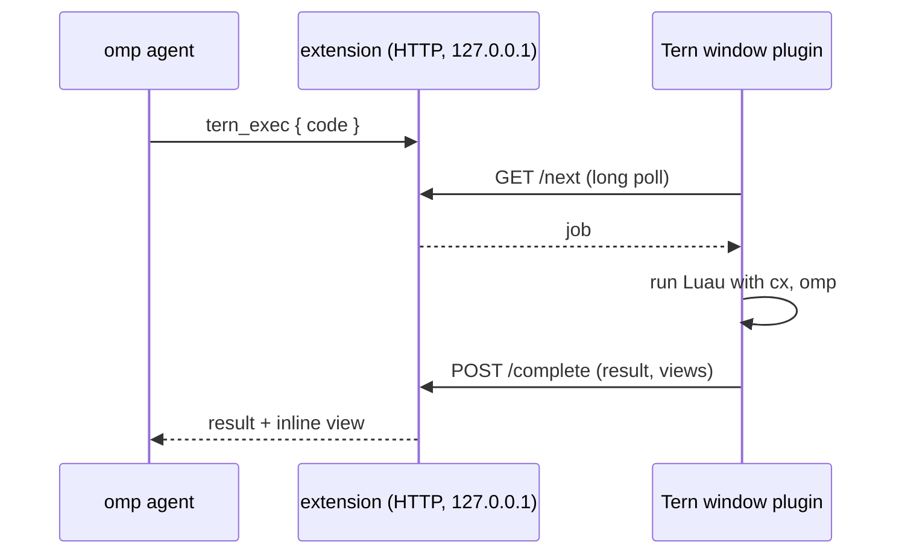

# tern-omp-bridge

`tern-omp-bridge` gives [omp](https://github.com/can1357/oh-my-pi) agents running in [Tern](https://stencil.so/tern) a `tern_exec` tool. The tool runs Luau inside the live Tern window, with the real `tern` API and window context, and returns the result to the agent. Scripts can also draw native views, either inline in the tool result or in a canvas pane beside the agent, and send button clicks and form input back to the agent.

The agent can use it to:

- inspect or control the window: panes, tabs, layout, other agents, git, processes, the browser
- show a table, chart, checklist or diff as a native view instead of text
- ask for a choice with buttons and wait for the click (`waitForAction`)

## How it works

There are two halves, so you install both:

- **omp extension** (`extension/`). In an omp session running inside a Tern pane, it starts an HTTP server on `127.0.0.1` with a random token. It writes a registration file to `$XDG_RUNTIME_DIR/omp-tern/` (mode 0600) and registers the `tern_exec` tool. Outside Tern it does nothing.
- **Tern window plugin** (`plugin.toml`, `window.luau`). Every two seconds it checks for registrations from omp agents in its own window, then long-polls each one for jobs. It runs each script with a fresh `cx` and an `omp` helper table (`show`, `close`, `view`, `on_action`, `emit`, `with_context`), then posts the result and any view changes back.



## Install

Install the Tern plugin:

```sh
tern plugin install github.com/theblazehen/tern-omp-bridge
```

Install the omp extension:

```sh
omp install github:theblazehen/tern-omp-bridge
```

Then restart omp, or start a new omp session in a Tern pane. The tool shows up as `tern_exec`.

To work on a checkout, link both halves instead:

```sh
tern plugin link .
omp install .   # a local path is linked, not copied
```

## Example

What an agent sends:

```json
{
  "code": "omp.show('hi', { placement = 'inline', view = { k = 'card', p = { head = 'Hello' }, c = { { k = 'badge', p = { text = 'OK', tone = 'success' } } } } })\nreturn #cx.session:panes()"
}
```

`extension/tool.md` is the tool description the model sees. It covers the inputs, the view API, action handling and the 50 ms callback budget.

## Requirements and limits

- Tested with Tern 0.9.5 and omp 18.12.5 on Linux.
- The plugin only accepts registrations from panes that Tern lists as agents in the same window and daemon socket.
- Scripts run with the full window API and are not sandboxed. Anything the agent sends runs as you.
- Tern callbacks have a 50 ms budget. A script that blocks inside a timer can disable the plugin's timers, which also stops discovery, until Tern reloads the plugin.

## License

GPL-3.0. See [LICENSE](LICENSE).
